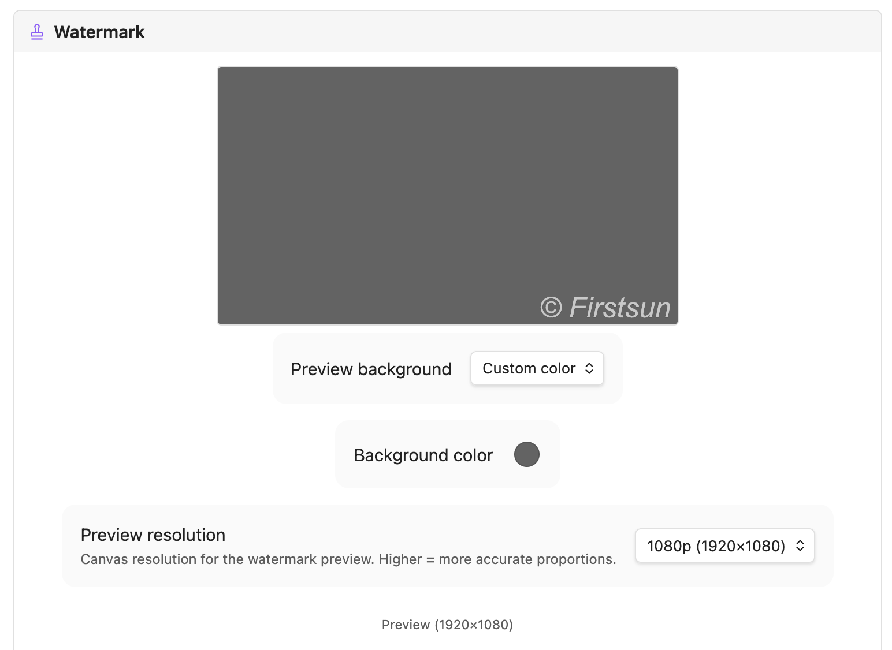

<div align="center">

# Paste to S3
*貼上圖片，自動最佳化、上傳、插入連結。*

[](https://github.com/firstsun-dev/watermark-bucket-uploader/actions/workflows/ci.yml)
[](https://github.com/firstsun-dev/watermark-bucket-uploader/releases)
[](https://obsidian.md/plugins?id=watermark-bucket-uploader)
[](LICENSE)

**[版本發布](https://github.com/firstsun-dev/watermark-bucket-uploader/releases)** · **[English](README.md)** · **[更新日誌](CHANGELOG.md)**

*前身為 Watermark Bucket Uploader。既有安裝與設定將照常運作。*

</div>

在 Obsidian 貼上圖片後，自動最佳化並上傳到自己的 S3-compatible storage，再插入 Markdown 圖片連結。這個 Obsidian 外掛攔截每一次貼上與拖放，自動最佳化圖片，上傳到你自己的 S3 相容儲存空間，然後把乾淨的 `` 直接寫進筆記。你的圖片、你的基礎設施。

```
貼上 / 拖放
    ↓
最佳化與壓縮
    ↓
轉換為 WebP
    ↓
選擇性浮水印
    ↓
上傳到 S3 相容儲存空間
    ↓
插入 Markdown 連結
```

   

<video src="assets/watermark-bucket-uploader-zh.webm" width="100%" controls autoplay loop muted playsinline></video>


*即時預覽會準確呈現文字與 Logo 浮水印套用後的效果——如果你選擇啟用的話。*

## 為什麼選擇 Paste to S3

- **貼上就好，繼續寫作** — 貼上或拖入圖片，它已經在你的 bucket 裡了。不用選單，不用對話框。
- **你的儲存空間，不是別人的服務** — 支援任何你已擁有並掌控的 S3 相容 bucket。自帶儲存空間。
- **更小的檔案，更快的頁面** — 自動 WebP 轉換與壓縮，讓儲存空間更精省，網頁載入更快速。
- **選擇性浮水印** — 需要時可疊加文字或 Logo，字體、大小、顏色、透明度、位置全部自訂，並有即時預覽。浮水印功能可完全關閉。
- **支援任何 S3 相容儲存** — Cloudflare R2、AWS S3、MinIO、Backblaze B2 等。
- **私密筆記不外洩** — 用 glob 規則排除特定資料夾，讓它們永遠不被上傳。
- **不只是圖片** — 可選擇性地以同樣方式上傳影片、音訊與 PDF。

## 安裝方式

### 從社群外掛安裝（推薦）
1. 開啟 **設定 → 社群外掛**，關閉限制模式。
2. 點擊 **瀏覽**，搜尋 **Paste to S3**，點擊 **安裝**，再點 **啟用**。

### 手動安裝
1. 從[最新發布版本](https://github.com/firstsun-dev/watermark-bucket-uploader/releases/latest)下載 `main.js`、`manifest.json`、`styles.css`。
2. 建立資料夾 `<vault>/.obsidian/plugins/watermark-bucket-uploader/`。
3. 將三個檔案複製到該資料夾。
4. 重新載入 Obsidian，並在 **設定 → 社群外掛** 中啟用此外掛。

## 快速開始

1. 安裝 **Paste to S3**。
2. 開啟 **設定 → Paste to S3**，填入你的 S3 相容儲存憑證（參見[儲存設定](#儲存設定)）。
3. 設定你的公開圖片網址。
4. 在任意筆記中貼上或拖入圖片——它會自動最佳化、上傳，並插入 `` 連結。

選用：可設定壓縮、WebP、浮水印、拖放上傳與資料夾排除規則。如需逐步設定 Cloudflare R2 與浮水印的詳細教學，請參閱 [Cloudflare R2 與浮水印設定指南](docs/how-to-setup-r2-and-watermarks.zh-TW.md)。

## 詳細設定

### 儲存設定

自帶儲存空間。Paste to S3 支援任何 S3 相容服務——AWS S3、Cloudflare R2、MinIO、Backblaze B2，或其他任何 S3 相容端點。

| 欄位 | 說明 |
|---|---|
| Access Key | S3 / R2 存取金鑰 ID |
| Secret Key | S3 / R2 私密金鑰（安全儲存於本地） |
| Region | 儲存桶區域（Cloudflare R2 填 `auto`） |
| S3 Bucket | 儲存桶名稱 |
| Bucket Folder | 可選路徑前綴，支援 `${year}`、`${month}`、`${day}`、`${basename}` |
| Custom Endpoint | R2 及非 AWS 服務必填 |
| Custom Image URL | 公開存取的 URL 基底，例如 CDN 或自訂網域 |

#### Cloudflare R2 快速設定

1. 在 R2 儀表板建立一個儲存桶。
2. 產生具有 **Object Read & Write** 權限的 API Token。
3. 將 **Custom Endpoint** 設定為 `https://<account-id>.r2.cloudflarestorage.com`。
4. 將 **Region** 設定為 `auto`。
5. 將 **Custom Image URL** 設定為你的公開儲存桶網域。

### 浮水印設定（選用）

浮水印功能預設關閉，可完全停用——若不需要可跳過此節。啟用後，可在設定頁面的**即時預覽**中即時查看調整效果。

| 欄位 | 說明 |
|---|---|
| **文字浮水印** | 開關文字疊加 |
| 文字 | 例如 `© yourdomain.com` |
| 字體 / 大小 / 樣式 / 顏色 | 完整排版控制；大小填 `0` 可自動縮放（圖片寬度的 2%） |
| **Logo 浮水印** | 開關圖片疊加 |
| Logo 路徑 | Vault 相對路徑，例如 `_assets/logo.png` |
| Logo 大小 / 透明度 | 縮放比例（佔圖片寬度百分比）與透明度（0–1） |
| 位置 | 右下、左下、置中下方或置中 |
| X/Y 偏移 | 微調位置（±% 圖片尺寸） |
| 預覽解析度 | 預覽畫布解析度（720p–4K） |

## 日常使用

| 操作 | 結果 |
|---|---|
| 在任意筆記中按 `Ctrl/Cmd+V` | 攔截圖片、處理、上傳，並插入 `` |
| 拖放圖片到編輯器 | 同樣流程（需在設定中啟用「拖放上傳」） |
| 命令面板 → `Upload image` | 手動選取本地檔案上傳 |
| 建立時自動上傳 | 任何新增至 Vault 的圖片將自動上傳並從本地刪除 |

## 隱私與安全

- **本地儲存** — bucket 憑證僅儲存在你本機 Vault 內的外掛資料夾中，只會傳送至你設定的儲存端點。
- **無遙測** — 本外掛不會收集任何使用數據或分析資訊。

## 系統需求

- Obsidian **1.6.6** 或以上版本
- 支援桌面與行動裝置

## 開發

```bash
git clone https://github.com/firstsun-dev/watermark-bucket-uploader.git
pnpm install

pnpm run dev    # 監看模式建置
pnpm run build  # 型別檢查 + 正式建置
pnpm run test   # vitest 測試套件
pnpm run lint   # eslint 檢查
```

## 授權條款

MIT

---

**Created by [ClaudiaFang](https://github.com/firstsun-dev)**
